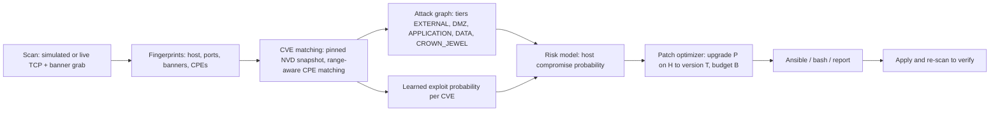

# Exploit-Aware Attack-Graph Prioritization with Learned Edge Probabilities and Budgeted Remediation Synthesis

**Authors:** TODO &nbsp;|&nbsp; **Affiliation:** TODO &nbsp;|&nbsp; **Target venue:** TODO (workshop, security-adjacent conference, or arXiv first)

> **Status: first draft.** Every number below is taken from the files in `results/` and `results/eval/`; the source is
> named in brackets, e.g. [`results/metrics.json`]. Open items for the authors: (1) verify every reference (they were
> written from memory), (2) draw Figure 1 (a draft is given as a Mermaid diagram), (3) fill in authors and venue,
> (4) decide whether to retrain the shipped model from 2020 (Section 5.4), (5) cut to the venue's page limit.

---

## Abstract

Vulnerability scanners list thousands of CVEs, and CVSS ranks them by severity, not by whether an attacker can use them
to reach what matters. We present NetSentinel, a Java-native pipeline that scans a network, builds an attack graph, and
chooses a small set of software upgrades that most reduces the probability that crown-jewel hosts are compromised. Three
ideas drive it. First, edge probabilities come from a model trained on real exploitation data (CISA KEV, with a temporal
train/test split) instead of CVSS formulas; the model reaches AUROC 0.806 against 0.735 for CVSS and 0.632 for EPSS
taken at publication time (a fair baseline, unlike today's EPSS, which already encodes later exploitation). Second, host
compromise probability treats "this CVE works on this host" as one event shared by all attackers, which avoids the
over-counting of independent-edge models. Third, remediation is a budgeted choice of "upgrade product P on host H to
version T", where T comes from NVD fixed-in ranges, so the model knows which CVEs an upgrade removes, which remain, and
which new ones it introduces. On three hand-built topologies, a model-guided plan cuts crown-jewel risk by 90% with two
patches, where CVSS-first needs six to eight; on 30 random 50-host networks it needs 5.0 ± 0.4 patches while CVSS-first
stays near 0%. On a five-container Docker lab, applying the recommended upgrade and re-scanning removed every attack
route, as predicted. We report where the approach is weak: precision at the top of the ranking is low, probabilities
are calibrated on average but not better than a constant in Brier score, and the explicit attack graph grows
quadratically, which we address with a graph-free formulation that scales to 1,000 hosts.

---

## 1. Introduction

A scan of a mid-sized network easily reports hundreds or thousands of CVEs. The common triage rule, patch the highest
CVSS scores first, answers "how bad is this bug in isolation?", not "which patches stop an attacker from reaching the
database that matters?" Two facts make the rule weak. First, few CVEs are ever exploited: in our data, of
93,505 CVEs published in 2022-2024 only 406 (0.43%) were added to CISA's Known Exploited Vulnerabilities catalog (KEV)
within a year of publication. Second, whether a vulnerable host matters depends on position: a critical bug on an
isolated host is less urgent than a medium one on the only path to a crown-jewel server.

Attack graphs capture position, and exploit predictors such as EPSS capture likelihood, but they are rarely combined with
an explicit, budgeted patch decision that is evaluated against what practitioners do. This paper makes four contributions:

1. **Learned edge exploitability.** A gradient-boosted model trained on real exploitation labels (KEV within 365 days of
   publication) with a temporal split and a point-in-time EPSS baseline (Section 4).
2. **A correlated-exploit risk model.** Host compromise probabilities in which one exploit on one host is one event,
   with a Monte Carlo check of the approximation (Section 5).
3. **Budgeted remediation with fixed-in-version patches.** A patch is an upgrade to the version NVD says fixes the
   host's CVEs; the optimizer is evaluated against CVSS-first, exploit-probability-first, random, and Yen-path-first
   baselines (Section 6).
4. **A reproducible, Java-native pipeline** with a real TCP/banner scanner, a Docker lab in which plans are applied and
   verified by re-scanning, and an evaluation harness (Sections 3 and 7). Code, scripts and results are in the repository.

We state limitations plainly (Section 8): the risk counts known CVEs only, reachability follows a declared zone model,
and several of our networks are small or synthetic.

## 2. Related work

*(All references below must be verified before submission.)*

**Attack graphs and logic-based analysis.** Sheyner et al. generate attack graphs by model checking [1]; MulVAL derives
attack paths from Datalog rules over vulnerability and topology facts [2]. We use a much simpler, tier-based
reachability model and focus on probabilities and remediation instead of derivation.

**Probabilistic attack graphs.** Bayesian attack graphs assign compromise probabilities to nodes and combine them along
the graph [3, 4, 5]. Our correlated variant differs in one modelling choice: a vulnerability on a host is a single shared
event instead of independent per-edge attempts.

**Exploit prediction and prioritisation.** Bozorgi et al. and Sabottke et al. learn exploitability from vulnerability
features and social signals [6, 7]; Allodi and Massacci show that CVSS severity is a poor predictor of exploitation [8];
EPSS provides a public, regularly updated exploitation probability [9, 10]. We train on KEV [11], evaluate with a temporal
split, and compare against EPSS taken at the time a CVE appears, because the current EPSS score already reflects later
exploitation.

**Network hardening.** Wang et al. compute minimum-cost hardening sets over attack graphs [12], and Dewri et al. optimise
hardening on attack trees with multiple objectives [13]. These assume given edge probabilities or costs; ours are learned
and the decision unit is a version upgrade with explicit residual and newly introduced CVEs.

## 3. System design

Figure 1 shows the pipeline.

*Figure 1 (draft). NetSentinel pipeline.*

**Scanning.** A live scanner opens TCP connections on virtual threads, reads server greetings, and sends an HTTP GET,
a redis `INFO` and a memcached `version` probe until a fingerprinter recognises the product. A version is reported only
if it appears in the response. Banner-to-CPE mapping was checked on 23 labelled banners (all correct) and on the five
live lab services (five of five correct). A scan cannot know an asset's role, so tier (DMZ, application, data, crown
jewel) and criticality (1-10) come from a declared inventory. A simulated network of 15 hosts plus a virtual attacker is used for tests.

**CVE matching.** CVEs come from a pinned NVD snapshot (497 CVEs for the products in the simulated network and the lab,
fetched on 2026-10-11 and extended on 2026-10-12). CPE matching handles wildcards and version ranges (`>=`, `>`, `<=`, `<`) and was checked on
33 hand-labelled cases.

**Attack graph.** Nodes are hosts; an edge (source, target, CVE) exists when the CVE has a network attack vector on the
target and the tier rules allow the source to reach it: EXTERNAL → DMZ → APPLICATION → DATA → CROWN_JEWEL, with lateral
movement inside the application and data tiers. Only known network-exploitable CVEs create edges.

**Implementation.** Java 21 with virtual threads for scanning, Spring Boot for the service, JGraphT for graphs; training
runs offline in Python and the model is shipped as JSON and evaluated in plain Java (Section 4.4).

## 4. Learned exploitability

### 4.1 Data and label
We build a dataset from NVD (CVSS v3 vectors, CWE, affected products), the KEV catalog, Exploit-DB and EPSS archives:
301,731 CVEs published 2016-2026 with a CVSS v3 vector [`data/manifest.json`]. The label is *added to KEV within 365 days
of publication*. A fixed horizon avoids right-censoring: only CVEs published at least 365 days before the data snapshot
(2026-10-11) are used.

### 4.2 Features and models
146 features: base score, one-hot attack vector, complexity, privileges, user interaction, scope and impact metrics, CWE
(top 60 plus other), vendor (top 60 plus other), and the log of the number of affected CPEs. We compare CVSS score
ranking, EPSS, logistic regression, a gradient-boosted tree model (depth 4, 300 iterations, learning rate 0.05), and an
MLP (32-16).

### 4.3 Evaluation protocol
Temporal split: train on CVEs published up to 2021 (93,159 CVEs, 175 positives), test on 2022-2024. For a fair EPSS
baseline we use the first monthly EPSS snapshot after each CVE's publication, and we drop test CVEs that were already in
KEV when that snapshot was taken, so every method predicts *future* exploitation: 91,882 test CVEs, 165 positives
(0.18%). Today's EPSS score is reported as a leaky reference only. Confidence intervals are bootstrap 95% intervals.

### 4.4 Results

| Model | AUROC [95% CI] | PR-AUC | ECE | mean prediction (observed 0.0018) |
|---|---|---|---|---|
| CVSS score | 0.735 [0.695, 0.766] | 0.005 | n/a (not a probability) | n/a |
| EPSS at publication | 0.632 [0.579, 0.674] | 0.035 [0.014, 0.063] | 0.0038 | 0.0045 |
| Logistic regression | 0.775 [0.741, 0.812] | 0.009 | 0.0011 | 0.0019 |
| **Gradient-boosted trees** | **0.806 [0.776, 0.835]** | 0.009 [0.007, 0.014] | **0.0006** | 0.0016 |
| MLP | 0.719 [0.680, 0.759] | 0.006 | 0.0023 | 0.0020 |
| *EPSS today (leaky reference)* | *0.976* | *0.360* | *0.0179* | *0.0197* |

*Table 1. Temporal test set, label = KEV within 365 days [`results/metrics.json`]. Figure 2: `results/calibration.png`.*

The learned model ranks better than CVSS and than EPSS at publication time (intervals do not overlap on AUROC).
EPSS at publication is better at the very top of the ranking (PR-AUC 0.035 against 0.009), but the intervals overlap.
Today's EPSS scores 0.976 because it already encodes later exploitation; it is not a valid baseline for this task. The
predictions are calibrated on average (ECE 0.0006) but the Brier skill score against a constant base-rate predictor is
about zero (-0.001): with a 0.18% base rate the model separates CVEs better than CVSS, not sharply enough to beat the
constant in squared error. **Ablation** [`results/ablation.json`]: removing the CVSS fields lowers AUROC to 0.760,
removing the affected-CPE count to 0.768, vendor to 0.804 and CWE to 0.805; CWE contributes nothing measurable.

### 4.5 Other labels and training years
`results/label_experiments.md` repeats the experiment with other targets and training windows.

* **Exploit-DB label** (a public exploit within 365 days): AUROC 0.691 against 0.664 (CVSS) and 0.639 (EPSS at
  publication), but badly calibrated (4.1% predicted against 0.34% observed) because the share of CVEs with a public exploit
  falls from 6-8% for 2016-2018 to under 1% from 2022. 869 of 4,179 training positives (21%) were CVE-id mapping errors
  (an exploit dated years before the CVE) and were removed. KEV is the better target for calibrated probabilities.
* **Metasploit label:** not evaluable with this source: the modules mirrored in Exploit-DB end in May 2020, so no CVE of
  the test years has one.
* **KEV left truncation.** KEV started in November 2021, so a CVE published before about 2020 can hardly be a positive
  (0.00% for 2016-2019). Training on 2020-2021 only keeps all 175 positives and raises the tree model's AUROC from 0.806
  to 0.826 (ECE 0.0015). The headline comparison holds either way; the shipped model is trained on all eligible years.

## 5. Risk model

### 5.1 Host compromise probability
The attacker starts at the EXTERNAL node with probability 1. Let $S(t)$ be the hosts that can reach $t$ and $C(t)$ the
network-exploitable CVEs of $t$, each with exploit probability $p_c$ from Section 4. Two variants are defined:

* **Noisy-OR (independent edges):** $P(t) = 1 - \prod_{(s,c)} \bigl(1 - P(s)\,p_c\bigr)$.
* **Correlated (shared exploit):** $P(t) = 1 - \prod_{c \in C(t)} \Bigl(1 - p_c \bigl(1 - \prod_{s \in S(t)} (1 - P(s))\bigr)\Bigr)$.

In the correlated variant an exploit either works on a host or does not, whoever launches it; with many attackers the
noisy-OR model counts the same exploit many times. Both are solved by fixed-point iteration from zero, which converges
monotonically. The objective is the expected criticality-weighted number of compromised crown jewels,
$R = \sum_{j \in J} (\kappa_j / 10)\,P(j)$, with $\kappa_j$ the declared criticality.

CVEs already in KEV receive a probability floor of 0.9, a hand-chosen constant: the model predicts future exploitation,
which understates observed exploitation.

### 5.2 Accuracy of the approximation
The formulas treat the compromise of different sources as independent. On graphs with cycles a host can support its own
compromise, so the fixed point is an upper bound; a four-node example gives 1/7 analytically against 0.125 exact. We
check the approximation with a Monte Carlo sampler that draws each exploit event once per trial: on optimal and greedy
plans the two agree within about 3% (for example 0.0033 against 0.0034), and on a graph without cycles they match
exactly (unit tests on chain, diamond and shared-exploit graphs).

## 6. Budgeted remediation

### 6.1 Patch units and fixed-in versions
A patch unit is "upgrade product P on host H". Its target version $T$ is the smallest version that escapes every fixable
CVE of the unit, computed from NVD fixed-in ranges: for each CVE the entry covering the current version gives the first
unaffected version, and the planner iterates because moving to $T$ can land in another affected range. CVEs that affect
all versions or have no upper bound cannot be fixed by upgrading and remain (*residual*). The CVE database is then
queried for the target version: CVEs affecting $T$ but not the current version are added to the host (*introduced*).
The risk model removes only fixed CVEs and adds introduced ones, and re-scan verification replaces the installed CPE by
the target CPE, so prediction and verification share one definition.

This matters: an earlier version assumed an upgrade removes all CVEs of the product; a real upgrade of redis to 6.2.20
left two CVEs (NVD lists them as affecting every version below 8.6.3) and the realised risk reduction was 97% where 100%
was predicted. With fixed-in semantics, predicted and re-scanned risk agree to $10^{-9}$ for every strategy and budget in
the end-to-end test.

### 6.2 Optimization
We choose at most $B$ units minimising $R$. The objective is not linear (it is a probability over graph reachability),
so an integer program would need a linearisation; instead we use:

* **Exact:** exhaustive search over subsets, used where the search space is small (at most 25 patch units in the
  evaluation); it prefers the smallest set reaching the lowest risk.
* **Greedy:** repeatedly apply the unit with the largest marginal risk reduction.
* **Baselines:** *CVSS-first* (rank units by the highest CVSS they carry), *exploit-probability-first* (highest model
  probability, ignoring position), *Yen path-first* (units on the highest-risk routes found by Yen's K-shortest paths,
  K = 10, edge weight $-\ln p$), and *random* (mean of 200 draws).

## 7. Evaluation

### 7.1 Setup
Topologies: three hand-built networks (the 15-host *enterprise* network, the five-host Docker *lab*, and an eleven-host
*web shop*; each also has the virtual attacker node), and synthetic networks of 50 and 200 hosts (30 random seeds each; 10% DMZ, 30% application, 50% data, 10%
crown jewels, one or two products per host). Strategy runs use budgets 0-10. Timings were measured on an AMD Ryzen 5
4600H (6 cores), 7.4 GB RAM, Java 24 with a 6 GB heap, Windows 11, with Docker Desktop running [`results/eval/environment.txt`].
Means are reported with 95% confidence intervals (Student t).

### 7.2 Which patches to choose
Share of patches needed to cut crown-jewel risk by 90% (first budget reaching it, within 10 patches):

| Topology | CVSS-first | Exploit-prob-first | Yen path-first | Random | **Greedy** | **Exact** |
|---|---|---|---|---|---|---|
| Enterprise (15 hosts) | 8 | 5 | 6 | not reached | **2** | **2** |
| Lab (5 hosts) | 1 | 2 | 1 | 3 | **1** | **1** |
| Web shop (11 hosts) | 6 | 6 | 6 | 9 | **2** | **2** |
| 50-host synthetic (30 seeds) | 0/30 reach | 0/30 | 0/30 | 0/30 | 30/30, **5.0 ± 0.4** | not run |
| 200-host synthetic (30 seeds) | 0/30 | 0/30 | n/a | 0/30 | 0/30 (78% at 10) | not run |

*Table 2 [`results/eval/summary.md`, `strategies.csv`]. Figure 3: `results/eval/fig_risk_vs_budget.png`.*

On the 50-host networks, mean risk reduction at five patches is 91.7 ± 2.2% for greedy, 42.1 ± 5.4% for Yen path-first,
7.0 ± 0.4% for random, 0.3 ± 0.5% for CVSS-first and 0.0% for exploit-probability-first. Yen path-first plateaus because the
top-K routes share the same chokepoints; after the first patches it adds nothing. Greedy equals the exact optimum on the
lab and web-shop networks and falls slightly short on the enterprise network at five patches (99.7% against 100%).

**Rank agreement.** The Kendall tau-b between the exact single-patch risk reduction and each heuristic score is close to
zero on synthetic networks (Yen 0.05 ± 0.03, CVSS -0.00 ± 0.03, exploit probability 0.10 ± 0.03 at 50 hosts), higher on
the small hand-built ones (CVSS 0.94 on the lab, 0.21 on the enterprise network), so a score computed per vulnerability
or per route is a poor proxy for the effect of a patch on the whole graph [`ranking.csv`].

### 7.3 Case study: the Docker lab
Five containers run Apache 2.4.49, nginx 1.18.0, two redis 6.2.6 and memcached 1.6.9. The scanner identified all five
versions from banners. The graph contains the chain *internet → web-dmz / proxy-dmz → app-cache → data-memcached →
secrets-vault* (crown jewel, criticality 10). The model rates the redis CVEs low (about 2% each), so the absolute
crown-jewel risk is small (0.0024), but the optimizer finds that one upgrade, redis on `app-cache` from 6.2.6 to 8.6.3
(fixing 22 CVEs, none remaining), cuts every route. We applied it by recreating only that container on `redis:8.6.3-alpine`
and re-scanned: risk 0.0024 → 0, attack routes removed, CVEs 143 → 121, as predicted.

### 7.4 Scalability
The explicit attack graph has one edge per (source, target, CVE), so it grows quadratically: 38,930 edges at 50 hosts,
636,861 at 200 and 2,571,236 at 400. We made four changes and measured them against the earlier code (Table 3):
scoring each distinct CVE once (the probability does not depend on the attacker), sharing the "does any source reach
this host" product between a host's CVEs, running Yen's algorithm on one edge per host pair, and a *graph-free* compile
that derives the same model from hosts and tier rules without edges (equality with the explicit model is a unit test on
random patch sets).

| Hosts | Stage | Baseline code | Optimised (explicit graph) | Graph-free |
|---|---|---|---|---|
| 200 | edge scoring | 3.56 s | 0.14 s | not needed |
| 200 | one risk evaluation | 4.4 ms | 0.4 ms | 0.5 ms |
| 200 | Yen top-5 | 14.1 s | 1.04 s | n/a |
| 200 | greedy, 5 patches | 6.02 s | 0.43 s | 0.34 s |
| 400 | greedy, 5 patches | 41.3 s | 3.5 s | 1.4 s |
| 1000 | compile / greedy 5 patches | infeasible (about 15M edges) | infeasible | 1.6 s / 22.7 s |

*Table 3 [`results/eval/scale.csv`, `scale_baseline.csv`]; 30 runs up to 200 hosts, 5 at 400 and 1000 (baseline: 10 and 3).
Figure 4: `fig_scalability.png`. The Yen speed-up also reflects a change of semantics: the top-K are now distinct host
routes instead of CVE variants of one route.*

**Scan concurrency.** With a simulated 20 ms of latency per probe and five probes per host, virtual threads finish
50, 200 and 1,000 hosts in 22, 23 and 27 ms; a fixed pool of 16 threads needs 331 ms, 1.29 s and 6.43 s; a pool of 256
needs 47 ms, 107 ms and 431 ms [`scan.csv`]. This benchmark uses blocking sleeps, not real traffic.

## 8. Threats to validity

* **Known CVEs only.** The risk ignores unknown vulnerabilities and misconfigurations, so "risk 0 after patching" means
  "no known exploitable route". Banner-based detection reports only versions that servers disclose; it was validated on
  23 labelled banners and five services.
* **Assumed reachability and roles.** Tiers and criticality are declared, and reachability follows a tier model
  (not measured firewall rules). Conclusions about which hosts matter inherit these inputs.
* **Labels are proxies.** KEV records known exploitation, not all exploitation; EPSS and KEV have their own biases. The
  KEV label has a structural left truncation (Section 4.5), and the Exploit-DB label drifts strongly over time.
* **Weak top-of-ranking precision and calibration.** PR-AUC is 0.009 at a 0.18% base rate, EPSS at publication is better
  at the very top, and the Brier skill score over a constant is about zero.
* **Possible feature leakage.** The affected-CPE count is the second most important feature, but NVD revises
  configurations after publication, so it may encode later events. EPSS model versions are mixed across the years.
  The 0.9 floor for KEV CVEs is hand-chosen.
* **Small and synthetic networks.** Three hand-built topologies and five containers are small; the synthetic generator
  puts 10% of hosts in the crown-jewel tier and connects tiers fully, which favours strategies that target crown jewels
  directly (this is why CVSS-first looks close to useless there). Exact search was not run on synthetic networks.
* **Approximate inference.** The fixed point is an upper bound on cyclic graphs (Section 5.2); optimal means optimal
  for this objective.
* **Measurement conditions.** Timings were taken on a 7.4 GB laptop with Docker running; sizes of 400 and 1000 hosts have
  five runs; the scan benchmark uses simulated latency; the application itself still builds the explicit graph, so real
  scans above about 400 hosts stop with an error.

## 9. Conclusion

Prioritising patches by the effect on crown-jewel reachability, with exploit probabilities learned from real
exploitation, outperforms severity-based ordering on every topology we tried, and the plan it produces can be applied
and verified on real software. The weaknesses are equally clear: the learned probabilities rank well but are not sharp,
the model counts known CVEs only, and our networks are small. Future work includes a Metasploit-based label from the
framework repository, measured reachability instead of a declared zone model, wiring the graph-free formulation into the
service, and evaluation on larger real topologies.

## Reproducibility
Code, scripts and results: this repository. `scripts/build_dataset.py`, `fetch_epss_history.py`, `train.py` and
`export_model.py` rebuild the data and the model (about 20 minutes for the NVD download); `scripts/run_eval.ps1` and
`summarize_eval.py` reproduce Section 7; `lab/` and `lab/apply_plan.py` reproduce the case study. 45 JUnit tests cover
matching, the risk model, the optimizer and an end-to-end re-scan check.

## References (verify before submission)
1. O. Sheyner, J. Haines, S. Jha, R. Lippmann, J. Wing. *Automated generation and analysis of attack graphs.* IEEE S&P, 2002.
2. X. Ou, S. Govindavajhala, A. Appel. *MulVAL: a logic-based network security analyzer.* USENIX Security, 2005.
3. Y. Liu, H. Man. *Network vulnerability assessment using Bayesian networks.* SPIE, 2005.
4. M. Frigault, L. Wang, A. Singhal, S. Jajodia. *Measuring network security using dynamic Bayesian network.* QoP, 2008.
5. N. Poolsappasit, R. Dewri, I. Ray. *Dynamic security risk management using Bayesian attack graphs.* IEEE TDSC, 2012.
6. M. Bozorgi, L. Saul, S. Savage, G. Voelker. *Beyond heuristics: learning to classify vulnerabilities and predict exploits.* KDD, 2010.
7. C. Sabottke, O. Suciu, T. Dumitras. *Vulnerability disclosure in the age of social media: exploiting Twitter for predicting real-world exploits.* USENIX Security, 2015.
8. L. Allodi, F. Massacci. *Comparing vulnerability severity and exploits using case-control studies.* ACM TISSEC, 2014.
9. J. Jacobs, S. Romanosky, B. Edwards, I. Adjerid, M. Roytman. *Exploit Prediction Scoring System (EPSS).* Digital Threats, 2021.
10. J. Jacobs et al. *Enhancing vulnerability prioritization: data-driven exploit predictions with community-driven insights.* 2023.
11. CISA. *Known Exploited Vulnerabilities Catalog.* https://www.cisa.gov/known-exploited-vulnerabilities-catalog
12. L. Wang, S. Noel, S. Jajodia. *Minimum-cost network hardening using attack graphs.* Computer Communications, 2006.
13. R. Dewri, N. Poolsappasit, I. Ray, D. Whitley. *Optimal security hardening using multi-objective optimization on attack tree models of networks.* ACM CCS, 2007.
